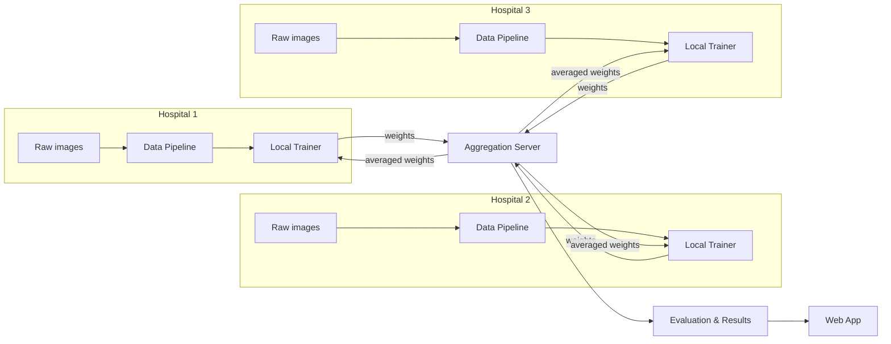
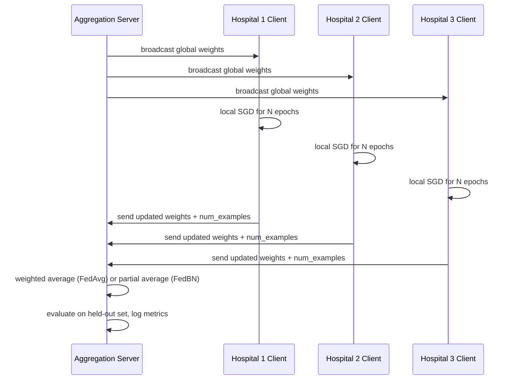
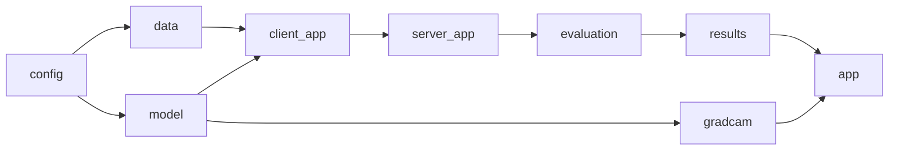

# High-Level Design — MediFed

This document describes the system architecture approved by the project guide. It is kept aligned with that approved design and updated as each phase is implemented.

---

## 1. Components

| Component | Responsibility |
|---|---|
| Data Pipeline | Load, filter, cap and transform chest X-ray images per hospital |
| Model | ResNet18 with 4-class output head; shared weights across hospitals |
| Hospital Clients | Local training loop; send weight updates; keep BatchNorm local in FedBN mode |
| Aggregation Server | Collect updates, run FedAvg or FedBN aggregation, broadcast new weights |
| Evaluation | Per-hospital accuracy/loss; cross-hospital aggregate metrics |
| Explainability | Grad-CAM heatmap via PyTorch hooks on the final conv layer |
| Web Application | Dashboard (training results) and Diagnosis Page (upload, predict, heatmap) |

---

## 2. Data Flow



Raw images never leave their hospital subgraph. Only weight tensors cross the boundary to the server.

---

## 3. Federated Training Round (Step by Step)



---

## 4. Baseline vs Personalized Mode

| Aspect | FedAvg (baseline) | FedBN (personalized) |
|---|---|---|
| Layers averaged | All layers | All layers except BatchNorm |
| BatchNorm state | Shared | Local to each hospital |
| Benefit | Simple, well-understood | Adapts to each hospital's image distribution |
| Saved output | `results/fedavg_results.json` | `results/fedbn_results.json` |

Both modes use the same Flower deployment runtime (flower-superlink + flower-supernode). The mode is selected via a config flag passed through `train_config`.

---

## 5. Deployment View

```mermaid
flowchart TD
    subgraph Local Machine
        SL[flower-superlink\n(aggregation server process)]
        SN1[flower-supernode --node-config partition-id=1]
        SN2[flower-supernode --node-config partition-id=2]
        SN3[flower-supernode --node-config partition-id=3]
        APP[Flask / web app\nlocalhost:5000]
    end
    SL <--> SN1
    SL <--> SN2
    SL <--> SN3
    SL --> CKPT[checkpoints/]
    CKPT --> APP
    APP --> BROWSER[Browser]
```

All processes run on the same Windows 11 machine. The web app reads saved checkpoints; it does not interact with the Flower runtime at inference time.

---

## 6. Module Dependency


