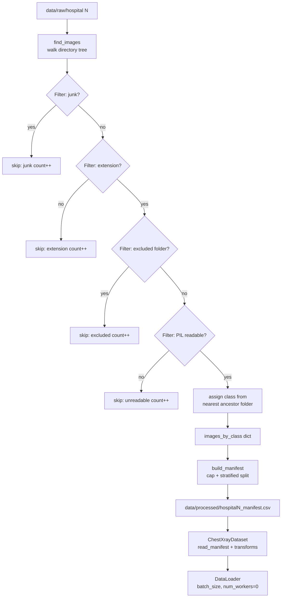

# Data Pipeline — MediFed

## Purpose

The data pipeline loads chest X-ray images from three hospital directories, applies a sequence of filters to remove junk and corrupt files, caps each class to a fixed maximum, splits into train and validation sets, and exposes the result as a PyTorch Dataset and DataLoader. No image ever leaves its hospital directory; only the manifest CSV (a list of relative paths and labels) is written to `data/processed/`.

---

## Data Flow



---

## Filtering Rules

| Rule | Reason |
|---|---|
| Skip filenames starting with `._` | macOS AppleDouble metadata files that have image extensions but are not images |
| Skip files whose extension is not in `(.jpg, .jpeg, .png)` | Avoids non-image files (text, XML, masks in other formats) that may appear in Kaggle downloads |
| Skip any folder named `masks` (any case) | The COVID-19 dataset ships segmentation masks alongside X-rays; they must not be treated as training images |
| Skip any folder named `Lung_Opacity` | A class present in the full COVID-19 dataset that is not part of the four-class global mapping |
| Skip any folder named `__MACOSX` | macOS archive artefact folder present in some Kaggle zip downloads |
| Skip files that PIL cannot open | Catches truncated or corrupt downloads without crashing the pipeline |

---

## Class Mapping

The global class order is defined once in `medifed/config.py` and used by all hospitals:

| Index | Class |
|---|---|
| 0 | COVID19 |
| 1 | NORMAL |
| 2 | PNEUMONIA |
| 3 | TUBERCULOSIS |

Each hospital's folder names are mapped to this global order via `FOLDER_TO_CLASS` in `config.py`. The class of an image is determined by the nearest ancestor folder whose lowercase name appears in `FOLDER_TO_CLASS`. This handles layouts where images sit inside a sub-folder (e.g. `COVID19/images/x.png` → class `COVID19`).

---

## Cap and Split Policy

- Per-class cap: `MAX_IMAGES_PER_CLASS = 500`. If a class has more images, a random sample of 500 is taken using `random.Random(SEED=42)`. The sample is reproducible.
- Train/val split: `VAL_FRACTION = 0.2`. Applied per class (stratified). The same `random.Random(SEED=42)` instance is used, so the split is also reproducible.
- Typical split for a capped class of 500: 400 train, 100 val.

---

## How to Run

```powershell
.\venv\Scripts\Activate.ps1

# Build manifests and print per-hospital counts:
python scripts/prepare_data.py

# Verify manifests, load one batch per hospital, save sample grid:
python scripts/verify_data.py

# Run the full test suite (includes 12 data pipeline tests):
python scripts/run_tests.py
```

---

## Results (from `python scripts/prepare_data.py`)

### Hospital 1 — Guangzhou, China (paultimothymooney/chest-xray-pneumonia)

Skipped: junk=0, wrong extension=0, excluded folder=0, unreadable=0

| Class | Found | Kept | Train | Val |
|---|---|---|---|---|
| NORMAL | 381 | 381 | 305 | 76 |
| PNEUMONIA | 385 | 385 | 308 | 77 |

### Hospital 2 — Qatar Univ + Dhaka (tawsifurrahman/tuberculosis-tb-chest-xray-dataset)

Skipped: junk=0, wrong extension=0, excluded folder=0, unreadable=0

| Class | Found | Kept | Train | Val |
|---|---|---|---|---|
| NORMAL | 600 | 500 | 400 | 100 |
| TUBERCULOSIS | 600 | 500 | 400 | 100 |

### Hospital 3 — Qatar Univ et al. (tawsifurrahman/covid19-radiography-database)

Skipped: junk=0, wrong extension=0, excluded folder=0, unreadable=0

| Class | Found | Kept | Train | Val |
|---|---|---|---|---|
| COVID19 | 600 | 500 | 400 | 100 |
| NORMAL | 600 | 500 | 400 | 100 |
| PNEUMONIA | 600 | 500 | 400 | 100 |

Sample grid saved to `results/sample_grid.png` (3 rows × 4 tiles, one row per hospital).
